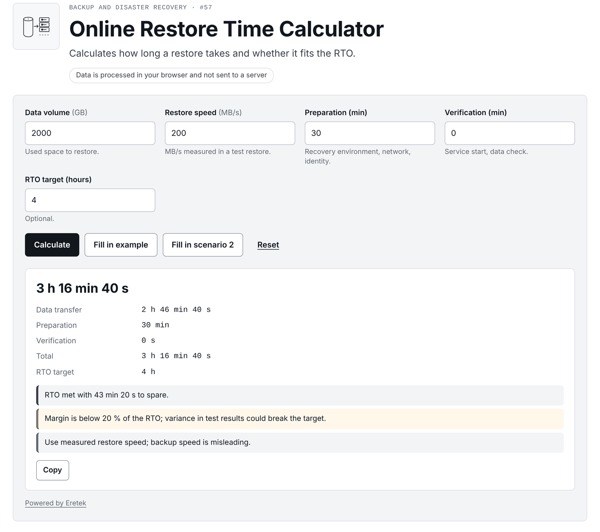

# Restore Time Calculator

Calculate the total recovery time from data volume, restore speed, preparation and verification, and see whether it meets the RTO target.

## Try it live

- [Türkçe](https://sistem.eretek.com/araclar/geri-yukleme-suresi)
- [English](https://sistem.eretek.com/en/tools/restore-time-calculator)
- [Deutsch](https://sistem.eretek.com/de/werkzeuge/wiederherstellungszeit-rechner)



## What it does

Calculates how long a restore takes and whether it fits the RTO.

Backup speed and restore speed differ: reading from deduplicated repositories, rehydration and target writes are usually slower. Hardware/VM preparation comes before the data transfer and application validation after it. The tool adds these steps up.

## Where it helps

Always take the speed from a real test restore, not from backup speed. If the RTO is not met, consider instant recovery, replication or faster storage.

## How to use it

1. Enter the data volume and measured restore speed.
2. Add preparation (hardware, network, VM creation) and verification (application test) in minutes.
3. Enter the RTO in hours; press Calculate.

### Fields

| Field | Description |
|---|---|
| Data volume | Used space to restore. |
| Restore speed | MB/s measured in a test restore. |
| Preparation (min) | Recovery environment, network, identity. |
| Verification (min) | Service start, data check. |
| RTO target (hours) | Optional. |

## Example input

Press **Fill in example** in the tool to load this input.

| Input | Value |
|---|---|
| Data volume | `2000` |
| Restore speed | `200` |
| Preparation (min) | `30` |
| RTO target (hours) | `4` |

**Expected result:** 2,000 GB at 200 MB/s → 2 h 46 min 40 s transfer + 30 min preparation = 3 h 16 min 40 s; meets the 4-hour RTO with 43 min to spare.

## Method and assumptions

Transfer = GB × 1000 / (MB/s) seconds. Total = transfer + preparation + verification. The difference to RTO is shown; a margin below 20 % gives a warning.

## Limits and common mistakes

- Parallel restores, network bottlenecks and application dependency order are not modelled; use the DR startup sequence tool for dependencies.

## Run it locally

The tool is plain HTML, CSS and JavaScript with no build step and no dependencies.

```bash
git clone https://github.com/eretek/restore-time-calculator.git
cd restore-time-calculator
node scripts/serve.js        # or: python3 -m http.server 8080
```

Open <http://127.0.0.1:8080/>. Add `?lang=tr` or `?lang=de` for Turkish or German; without it the page follows the browser language and falls back to English. You can also open `index.html` directly from disk.

Run the tests (Node.js 18 or later):

```bash
node test/run.js    # or: npm test
```

The tests run the tool's own fixtures and the worked examples in all three languages without a browser.

## How it works

All processing happens in your browser. The tool makes no network requests, uses no cookies or browser storage, and does not upload files you select.

No server-side component is needed. The version on the Eretek website renders the same page through a private WordPress plugin; that plugin only produces the page markup and is not part of this repository.

| Path | Purpose |
|---|---|
| `index.html` | Page shell |
| `src/app.js` | Builds the page in Turkish, English or German from `src/data.js` |
| `src/data.js` | Field definitions, examples and all texts in three languages |
| `src/core.js` | Shared runtime: validation, number formats, result rendering, CSV/ICS export |
| `src/tool.js` | The calculation or analysis for this tool |
| `docs/screenshot.png` | Screenshot used in this README |
| `src/tools.css`, `src/page.css` | Styles |
| `test/run.js`, `test/cases.json` | Headless tests |

## License and attribution

This tool is released under the [Eretek Website Attribution License](LICENSE). You may use, modify and redistribute it, including commercially. If you make it available on a website or web application, show a visible, clickable credit linking to https://eretek.com/ on every page where the tool is available, for example:

```html
<a href="https://eretek.com/">Powered by Eretek</a>
```

You may add `rel="nofollow"` to the link. Keep the copyright notice and license text in copies and redistributions.
